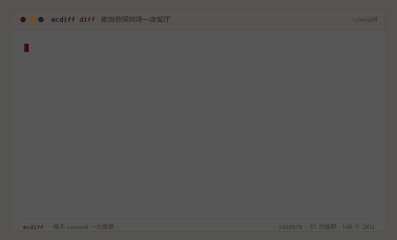

# 🍟 McDiff — 给麦当劳菜单建一个 git 仓库

> **每天给菜单打一次 commit：`git diff` 出今天谁涨价、谁下架。**

[](https://www.python.org/)
[](pyproject.toml)
[](tests/)
[](https://github.com/M-China/mcd-mcp-server)
[](LICENSE)



**[🎮 30 秒在线体验（免登录）](https://你的账号.github.io/mcdiff/)** · [快速开始](#-快速开始) · [它用到的 MCP 工具](#-它用到的-mcp-工具) · [数据与边界](#-数据与边界)

> 麦当劳程序员创意开发大赛参赛作品 · 非麦当劳官方产品

---

## 这是什么

菜单是会变的：今天 14.9 的随心配明天可能 15.9，上周还在的薯角这周就没了——但没有任何地方留下记录。

McDiff 把一家麦当劳门店的菜单当成代码仓库来管理：

1. **采集**：调用麦当劳中国 MCP 的 `query-meals`，把门店菜单（分类 / 编码 / 标签 / 现价 / 划线价）抓下来，存成一份带校验和的 JSON 快照；
2. **提交**：每次采集都是一次 commit，快照按 `门店/日期-餐段` 落盘，可以像翻 `git log` 一样翻菜单史；
3. **diff**：任意两次快照对比，输出真·`git diff` 风格的变更清单——新增、下架、涨价、降价、改名、标签调整、换分类；
4. **考古**：消失的 SKU 进「麦门考古博物馆」，每块墓碑记着它在架多少天、最后卖多少钱、最后一次出现在哪天。

一句话：**别人教你今天怎么点省钱，McDiff 记录菜单怎么变。**

## 👀 输出长这样

```diff
--- 2026-10-25 04:42 深夜
+++ 2026-10-25 05:05 早餐
@@ 麦当劳深圳湾一店餐厅（1420576） 75 → 72 个 SKU · +61 -64 ↑0 ↓0 ~0 @@
+ 1088         优品豆浆                   ¥9.50  新增
+ 1254         火腿扒麦满分               ¥10.00  新增
+ 2631         脆香油条                   ¥8.50  新增
+ 4437         玉米杯                     ¥13.00  新增
+ 4825         脆薯饼                     ¥8.50  新增
- 1100         巨无霸                     ¥25.50  下架
- 1120         双层吉士汉堡               ¥23.00  下架
- 1401         麦乐鸡                     ¥14.00  下架
- 1406         板烧鸡腿堡                 ¥23.50  下架
... 共 61 新上 / 64 下架
```

### 📌 第一手的发现：菜单是「换整本」的，不是「改几条」的

上面这段 diff 来自 2026-10-25 凌晨的真实采集（04:42 → 05:05，间隔 23 分钟）。**麦当劳不是在菜单上增删几条，而是在早餐时段开始的那一刻，把整本菜单换掉了**：64 个宵夜时段还能点的东西同时消失，61 个早餐 SKU 同时出现——巨无霸和双层吉士汉堡在 5 点整"下架"，猪柳蛋麦满分和豆浆"上架"。

如果没有快照，这件事永远不会被看见；有了快照，它变成一行 `- 1100 巨无霸 ¥25.50 下架`。

> 仓库里还带了 29 天示例快照（文件内 `"synthetic": true`），用于演示多天 diff 与博物馆；真实采集从 2026-10-25 04:42 开始，之后的每一份快照都不可伪造。

## ✨ 核心能力

| 能力 | 说明 | 依赖的 MCP Tool |
|---|---|---|
| 菜单快照 | 门店级菜单全量落盘，含分类、标签、价格、划线价、优惠类型，SHA-256 校验和去重 | `query-meals` |
| git 式 diff | `+ 新增 / - 下架 / ~ 涨价降价`，中文等宽对齐，可输出 `git` 文本 / Markdown / JSON | — |
| 菜单博物馆 | 追踪每个 SKU 的生命周期：首次出现、最后出现、在架天数、价格变化曲线、墓志铭 | — |
| 价格核验 | 用官方 `calculate-price` 对指定商品核价（金额单位为**分**），交叉验证菜单展示价 | `calculate-price` |
| 券与促销留痕 | 每次快照同时记录当前门店可用券、满减/折扣规则，方便日后做「券的门槛降了没」 | `query-store-coupons`、`query-promotions` |
| 门店选择 | 按城市 + 关键词找店，自动跳过未营业门店 | `query-nearby-stores` |
| 时间基准 | 所有快照带服务器时间与餐段（早餐/午餐/下午茶/夜市/深夜）标签 | `now-time-info` |
| 静态演示 | 一条命令导出 `docs/data.js`，纯前端页面可以 diff 任意两个时间点，**不需要 Token** | — |

## 🚀 快速开始

```bash
# 1) 申请 Token：https://open.mcd.cn/mcp → 手机号登录 → 控制台 → 激活 → 复制
export MCD_MCP_TOKEN="你的_token"        # Windows: setx MCD_MCP_TOKEN "..."

# 2) 找一家店（city 与 keyword 必须同时给）
python -m mcdiff stores --city 深圳市 --keyword 麦当劳

# 3) 采集一次
python -m mcdiff capture --store 1420576 --city 深圳市 --keyword 麦当劳

# 4) 再采一次，然后看 diff
python -m mcdiff capture --store 1420576
python -m mcdiff diff

# 5) 看博物馆 / 生成演示页
python -m mcdiff museum
python -m mcdiff report     # → docs/index.html（双击就能看）
```

想先看效果、没有 Token？仓库里已经带了一份快照：

```bash
python -m mcdiff seed --days 30   # 生成 29 天示例历史（全部标记 synthetic=true）
python -m mcdiff report           # 打开 docs/index.html
```

### 其他用法

```bash
python -m mcdiff doctor                 # 检查 Token / 连通性 / 工具数量
python -m mcdiff list                   # 列出本地快照
python -m mcdiff diff --json            # 机器可读的 diff
python -m mcdiff diff --from a.json --to b.json
python -m mcdiff capture --store 1420576 --anchors 9900013304,9900015568   # 顺带官方核价
```

## 💬 可以直接这么说

把 McDiff 当作 Agent Skill 用的时候，下面这些句子可以直接发给模型：

- 「帮我看看深圳湾那家麦当劳今天菜单变了什么」
- 「昨天到今天，有哪些东西涨价了？涨了多少」
- 「这个月下架了哪些餐品？给我一份墓碑清单」
- 「随心配的两件套现在是 14.9 吗？和上周比呢」
- 「把我常去的这家店菜单存一份快照，标注是早餐时段」
- 「这个门店现在有哪些券？和促销规则一起记下来」
- 「把最近 30 天的价格变化导成一张 diff 长图」
- 「核一下这两个组合的官方价格，菜单价和 calculate-price 对不对得上」

## 🧠 它是怎么算的

```
           McDonald's MCP (https://mcp.mcd.cn)
                    │  query-meals / calculate-price / query-store-coupons
                    ▼
   ┌───────────── snapshot.py ─────────────┐
   │ 归一化：code 为主键 · 价格转整数分     │
   │ 校验和：sha256(meals+categories)      │
   └───────────────┬───────────────────────┘
                   │  一次采集 = 一份不可变快照
                   ▼
   data/snapshots/<门店>/<日期T时分>-<餐段>.json
                   │
        ┌──────────┴───────────┐
        ▼                      ▼
     diff.py                museum.py
  按 code 比对两次快照     聚合全历史生命周期
  → + - ~ 文本 / MD / JSON  → 墓碑 + 墓志铭 + 价格曲线
```

三条原则：

1. **取数交给 MCP，算术交给本地代码**——不用模型猜价格，价格只有两个来源：菜单展示价（元）或 `calculate-price`（分）。
2. **code 是稳定主键**：`query-meals` 的餐品编码在门店内唯一且稳定，名字会改、分类会挪，code 不会。
3. **快照不可变**：每次采集写一个新文件，永不覆盖；diff 是纯函数，任何两个文件都能比。

## 📁 项目结构

```
mcdiff/
├── mcdiff/                 # 零依赖 Python 包
│   ├── mcp.py              # Streamable HTTP MCP 客户端（JSON-RPC、限流、重试、SSE 兼容）
│   ├── snapshot.py         # 采集 / 归一化 / 校验和 / 落盘
│   ├── diff.py             # 变更识别 + git/Markdown 渲染（中文等宽对齐）
│   ├── museum.py           # 生命周期聚合 + 墓志铭
│   ├── seed.py             # 确定性合成历史（演示用，强制标记 synthetic）
│   ├── report.py           # 导出前端数据 docs/data.js
│   └── cli.py              # doctor / stores / capture / list / diff / museum / seed / report
├── scripts/
│   ├── collect.py          # 定时采集器（GitHub Actions 也用它）
│   └── make_gif.py         # 生成 README 的 GIF 与社交图
├── data/snapshots/         # 快照数据（按门店分目录）
├── docs/                   # 单页演示（file:// 可开，GitHub Pages 可托管）
├── tests/                  # 61 个单元测试，全部 stdlib unittest
└── .github/workflows/snapshot.yml   # 每天定时采集并 commit
```

## ✅ 测试

```bash
python -m unittest discover -s tests -v
# Ran 61 tests ... OK
```

覆盖：MCP 协议层（本地起 HTTP server 模拟初始化 / 业务错误 / 401 / 429 重试 / SSE 帧）、价格单位换算、餐段边界、校验和稳定性、diff 六类变更与渲染、博物馆生命周期、合成数据确定性、CLI 端到端（含 `report` 产物）。

**所有测试都不需要 Token，也不访问外网。**

## 🔒 数据与边界

- **只读优先**：v0.1 只调用 6 个只读工具，不涉及下单、领券、抽奖等任何写操作。
- **Token 只从环境变量读**：`MCD_MCP_TOKEN`，仓库内没有任何真实 Token（见 `mcp-config.example.json`）。
- **不采集个人信息**：快照只存菜单与门店级券/促销摘要，不存地址、手机号、积分、券码。
- **示例数据必须标注**：`seed` 生成的每一天都带 `"synthetic": true`，页面上有「示例展品」徽章；真实采集从 2026-10-25 开始，快照文件不可伪造。
- **金额单位**：菜单是元（字符串），`calculate-price` 是分（整数）——本项目内部一律用整数分。
- **不是官方产品**：本项目与麦当劳中国无关，输出仅供参考；餐品信息、价格与供应状态以官方渠道为准。

## 📄 参赛材料

- [CONTEST_DECLARATION.md](CONTEST_DECLARATION.md)（官方原文，未改动）
- [MCP_INTEGRATION.md](MCP_INTEGRATION.md)（真实调用的 tool、时序、数据契约与踩坑记录）
- [mcp-config.example.json](mcp-config.example.json)（只含环境变量占位符）

## 🗺️ Roadmap

- [ ] 多门店并行快照（同城价格差异）
- [ ] 「券门槛变化」追踪：满减从 30 降到 25 的那一天
- [ ] 和你的历史订单打通：这件下架的餐品，你最后一次吃它是什么时候
- [ ] RSS / 邮件订阅：今日 diff 推送

## License

MIT
